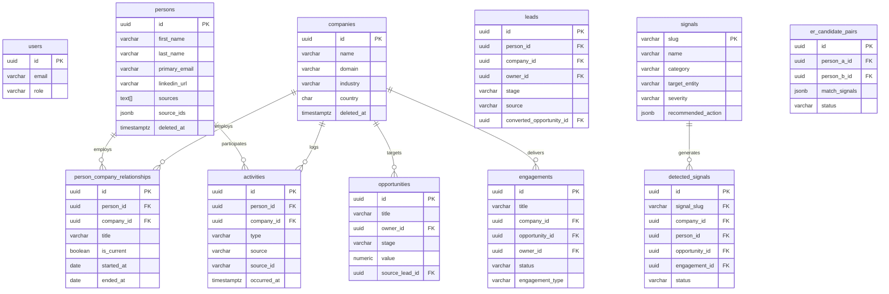

# CDB — Database Architecture & Schema

**Database Engine**: PostgreSQL 16  
**Schema Tracking**: Alembic (`src/backend/db/alembic/`)  
**ORM**: SQLAlchemy 2.0 (Async)  

For schema modification workflows, see the [Alembic Migrations Skill](../../../../.agents/skills/cdb-alembic-migrations/SKILL.md).  
For cloning and backup operations, see the [Database Operations Skill](../../../../.agents/skills/cdb-database-ops/SKILL.md).

---

## 📊 Entity Relationship Overview



---

## 🗄️ Core Schema Layers

All models are defined as SQLAlchemy 2.0 Declarative classes under [`src/backend/cdb/models/`](../cdb/models/):

| Layer | Primary Tables | Purpose | Source File |
|-------|----------------|---------|-------------|
| **Core Directory** | `persons`, `companies`, `person_company_relationships` | Master golden contact and account records | [`person.py`](../cdb/models/person.py), [`company.py`](../cdb/models/company.py), [`relationship.py`](../cdb/models/relationship.py) |
| **Interactions** | `activities` | Timeline events (meetings, messages, emails, calls) | [`activity.py`](../cdb/models/activity.py) |
| **Pipeline & Delivery** | `leads`, `opportunities`, `engagements` | Deal stages, conversion tracking, active contracts | [`lead.py`](../cdb/models/lead.py), [`opportunity.py`](../cdb/models/opportunity.py), [`engagement.py`](../cdb/models/engagement.py) |
| **Signals & NBA** | `signals`, `detected_signals`, `signal_feedback` | Opportunity/risk catalog, triggered signals, and feedback | [`signal.py`](../cdb/models/signal.py) |
| **Entity Resolution** | `er_candidate_pairs` | Review queue for ambiguous duplicate matches | [`er.py`](../cdb/models/er.py) |
| **Intake Staging** | `intake_linkedin_connections`, `intake_notion_meeting_notes`, etc. | Raw staging data before deduplication and merge | [`intake.py`](../cdb/models/intake.py) |
| **Audit & Changelogs** | `person_history`, `opportunity_history` | Field-level audit trails and temporal changelogs | [`person_history.py`](../cdb/models/person_history.py), [`opportunity_history.py`](../cdb/models/opportunity_history.py) |

---

## ⚙️ Running Migrations

```bash
cd src/backend
uv run alembic upgrade head
```
